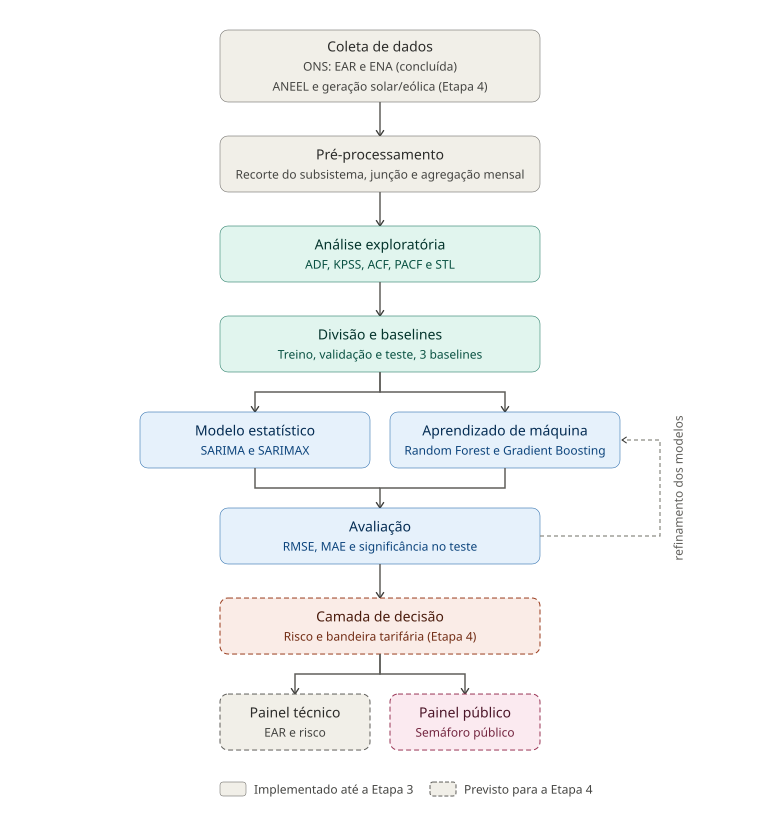
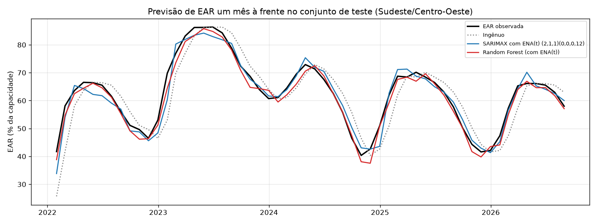

# Do Reservatório à Conta de Luz: Previsão de Risco Energético-Hídrico e Bandeiras Tarifárias no Brasil

Projeto desenvolvido para a disciplina **Projeto Aplicado IV**, Ciência de Dados EaD, Universidade Presbiteriana Mackenzie (2026/02).

## Equipe

- Cristiano Prado do Carmo, 10720249
- Bruna Mendes Rocha, 10441296


## Sobre o projeto

O Brasil possui uma matriz elétrica predominantemente hidrelétrica, o que cria uma relação direta entre a disponibilidade de água nos reservatórios e a segurança do fornecimento de energia. Ao mesmo tempo, o crescimento acelerado da geração solar e eólica tem introduzido novos desafios operacionais ao sistema, como o fenômeno do *curtailment* (corte de geração por excesso de oferta).

Este projeto propõe um modelo de previsão de séries temporais para estimar o nível futuro de Energia Armazenada (EAR) nos reservatórios do Sistema Interligado Nacional (SIN), utilizando a Energia Natural Afluente (ENA) e a geração solar/eólica como variáveis explicativas. A partir dessa previsão, são derivadas camadas de classificação de risco energético-hídrico e uma estimativa de bandeira tarifária, com o objetivo de gerar tanto informação técnica quanto informação acessível à população.


## Status do projeto

**Etapa 3 (implementação parcial) concluída.** O notebook contém a análise exploratória e o pré-processamento das séries de EAR e ENA do subsistema Sudeste/Centro-Oeste (2000 a 2026, passo mensal) e um modelo base com duas famílias de técnicas, comparadas a três baselines na previsão da EAR um mês à frente.



Desempenho no conjunto de teste (01/2022 a 08/2026, 56 meses), em pontos percentuais de EAR, medido pela raiz do erro quadrático médio (RMSE) e pelo erro absoluto médio (MAE):

| Modelo | RMSE | MAE |
|---|---|---|
| Random Forest (com ENA do mês alvo) | 2,13 | 1,72 |
| Gradient Boosting (com ENA do mês alvo) | 2,21 | 1,86 |
| SARIMAX (com ENA do mês alvo) | 2,86 | 2,17 |
| Gradient Boosting (sem ENA do mês alvo) | 2,83 | 1,94 |
| Random Forest (sem ENA do mês alvo) | 2,96 | 2,08 |
| SARIMA | 3,55 | 2,75 |
| Baseline: persistência + variação sazonal média | 3,17 | 2,21 |
| Baseline: ingênuo (mês anterior) | 6,07 | 4,69 |

As variantes "com ENA do mês alvo" são cenários condicionais, pois assumem a afluência do mês previsto como conhecida. Sem essa informação, os ganhos sobre o baseline sazonal são modestos e não significativos estatisticamente, o que orienta o refinamento da Etapa 4.



**Próximos passos (Etapa 4):** integrar bandeiras tarifárias da ANEEL e geração solar e eólica, prever a ENA ou usar cenários, estender os horizontes de previsão de 1 a 6 meses, implementar a camada de decisão (risco e bandeira) e o painel técnico e público.


## Objetivos de Desenvolvimento Sustentável (ODS)

- **ODS 11**: Cidades e Comunidades Sustentáveis (principal)
- **ODS 8**: Trabalho Decente e Crescimento Econômico (secundária)

## Fontes de dados

- **ONS, Portal de Dados Abertos** (dados.ons.org.br): Energia Armazenada (EAR) e Energia Natural Afluente (ENA) por subsistema, em base diária de 2000 a 2026, coletadas de forma automatizada pelo bucket público na AWS (`ons-aws-prod-opendata`). A geração solar e eólica está prevista para a Etapa 4.
- **ANEEL, Portal de Dados Abertos**: histórico de acionamento de bandeiras tarifárias, previsto para a Etapa 4.

## Estrutura do repositório

```
.
├── README.md
├── requirements.txt
├── notebooks/
│   └── cd_projeto_aplicado_IV_doc.ipynb   # Notebook principal do projeto
├── scripts/
│   ├── explorar_bucket_ons.py             # Descoberta dos datasets no bucket do ONS
│   ├── baixar_dados_ons.py                # Download automatizado de EAR e ENA
│   └── listar_arquivos_ear_ena.py         # Listagem dos arquivos disponíveis
├── data/
│   ├── raw/
│   │   ├── ear_subsistema/                # EAR diário por subsistema (2000-2026)
│   │   └── ena_subsistema/                # ENA diário por subsistema (2000-2026)
│   └── processed/                         # Gerados pelo notebook
│       ├── se_diario.csv                  # EAR e ENA diárias do Sudeste/Centro-Oeste
│       ├── se_mensal.csv                  # Série mensal usada na modelagem
│       └── resultados_modelo_base.csv     # Métricas dos modelos no teste
└── docs/
    └── img/                                # Figuras e diagramas usados no notebook
```

## Como executar

1. Clone o repositório e crie um ambiente virtual Python:
```bash
   python -m venv venv
```
2. Ative o ambiente:
   - Windows (PowerShell): `venv\Scripts\Activate.ps1`
   - Mac/Linux: `source venv/bin/activate`
3. Instale as dependências:
```bash
   pip install -r requirements.txt
```
4. (Opcional) Para atualizar os dados brutos, execute os scripts de coleta:
```bash
   python scripts/baixar_dados_ons.py
```
5. Abra `notebooks/cd_projeto_aplicado_IV_doc.ipynb` no Jupyter ou no VS Code, selecione o kernel do `venv` e use **Run All**. O notebook deve ser executado a partir da pasta `notebooks/`, pois usa caminhos relativos (`../data` e `../docs/img`). A execução completa leva cerca de 1 minuto e gera as figuras em `docs/img` e os dados tratados em `data/processed`.

## Cronograma de entregas

> O cronograma detalhado, semana a semana e vinculado aos objetivos específicos, está na seção "Cronograma" do notebook principal.

| Entrega | Checkpoint | Data | Conteúdo | Situação |
|---|---|---|---|---|
| Entrega 1 | 17/08 | 31/08 | Definição do tema, equipe, base de dados, documentação inicial | Concluída |
| Entrega 2 | 14/09 | 28/09 | Referencial teórico, pipeline da solução, cronograma | Concluída |
| Entrega 3 | 05/10 | 26/10 | EDA, pré-processamento, modelo base | Concluída |
| Entrega 4 | 02/11 | 30/11 | Implementação final, apresentação, documentação completa | Em andamento |

## Licença

A definir.